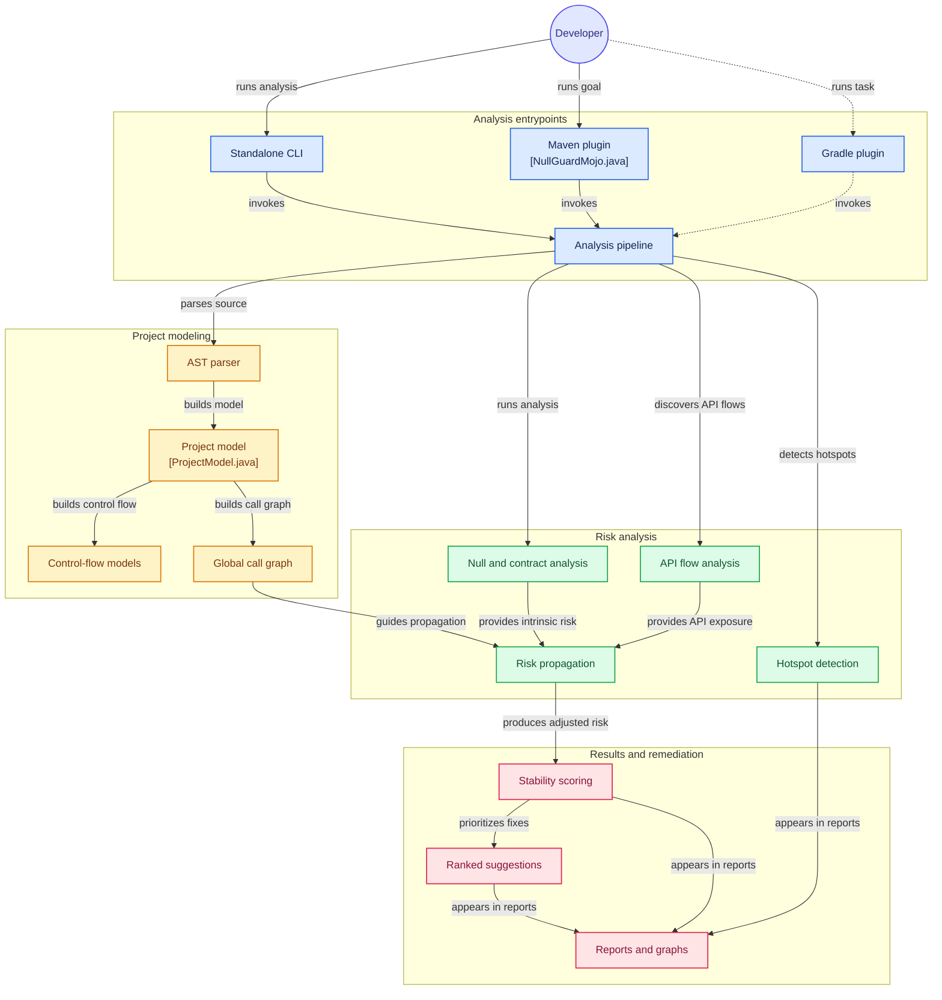

# NullGuard

[](https://github.com/techbhaskar/null-guard/actions/workflows/verify.yml)
[](https://codecov.io/gh/techbhaskar/null-guard)

NullGuard is a static stability-analysis engine for Java services. It parses a codebase, builds control-flow and call graphs, follows risk across method boundaries, identifies API-facing and high-blast-radius hotspots, calculates a project stability score, and produces prioritized remediation suggestions.

It is intended to answer questions that are difficult to answer with a method-level nullability warning alone:

- Where can a nullable value travel after it is introduced?
- Which controller, service, repository, or shared utility amplifies the most risk?
- Which REST endpoints can be affected by a risky downstream method?
- Which small set of fixes should a team prioritize first?
- Should a build be allowed to pass when a critical architectural hotspot is present?

NullGuard performs static analysis only. It does not instrument or run the analyzed application.

> **Release status:** `1.1.1` is published on Maven Central. See the [release notes and verification results](docs/releases/1.1.1.md).

> **GitHub source release `1.1.2`:** includes overload/constructor correctness fixes, local object lifecycle analysis, and analysis-completeness reporting. See the [release notes](docs/releases/1.1.2.md). Maven Central publication of `1.1.2` is pending; use a local build to try these changes.

## Multi-language preview in development

The `2.0.0-preview.1` source adds optional Python, JavaScript/TypeScript, C#, Go
and Rust packs. They are opt-in and experimental; release qualification is
pending. See the [installation, language examples, report guide and capability
limits](docs/multilang/README.md). Existing Maven/Gradle commands remain Java-only.


## Developer guide

Accuracy evaluation: see the [review protocol and corpus](docs/evaluation/accuracy-protocol.md)
for reproducible sampling, two-reviewer judgments, and measured false discoveries.
Independent human accuracy review is pending; historical selected labels are not
an overall precision estimate.

- [Choose Maven, Gradle, or the CLI](#first-run)
- [Gradle setup: Kotlin and Groovy DSL](#gradle-projects)
- [Maven setup and options](#recommended-usage-maven-plugin)
- [Standalone CLI](#standalone-cli)
- [Generate and open HTML reports](#generate-and-open-an-html-report)
- [Read findings, scores, and hotspots](#reading-the-results)
- [CI adoption](#suggested-ci-adoption)
- [Troubleshooting](#troubleshooting)

Registry installation examples below target **1.1.1**, available from Maven Central; source-build CLI commands target **1.1.2**. The previous signed standalone
CLI downloads remain on the [1.1.0 GitHub release page](https://github.com/techbhaskar/null-guard/releases/tag/v1.1.0).
For the authenticated GitHub Packages mirror of **1.1.0**, see [registry setup](docs/github-packages.md); a 1.1.1 mirror publication is not claimed.

## Why use NullGuard in microservices?

Microservices often look simple at the surface: a controller calls one or more services, repositories, clients, mappers, and shared utilities. A null-handling bug deep in that chain may not fail at compile time, but it can cascade across multiple endpoints and make the blast radius hard to reason about from local warnings alone.

NullGuard adds a project-level view that helps teams prioritize the real risk instead of chasing isolated nullability issues in isolation.

| Capability | Developer benefit |
| --- | --- |
| AST and symbol-aware parsing | Resolves overloaded methods, project types, inheritance, interfaces, JDK calls, and dependency calls more accurately than text matching alone. |
| Null-state and contract analysis | Highlights unsafe dereferences, nullable return paths, missing guards, and contract weaknesses. |
| Global call graph | Shows how risk travels across controller, service, repository, utility, and external-call boundaries. |
| API flow discovery | Connects annotated Spring MVC and JAX-RS entry points to downstream reachable methods. |
| Fixpoint risk propagation | Carries downstream risk back through callers until scores converge. |
| Blast-radius analysis | Finds risky methods used by many callers or API paths, which are usually the best fixes to make first. |
| Stability score and grade | Gives teams a repeatable project-level signal for reviews and CI. |
| Ranked suggestions | Recommends null guards, stronger contracts, external-return validation, risk-chain isolation, and hotspot refactoring. |
| JSON, DOT, and HTML reports | Supports machine processing, graph visualization, and human review. |
| Configurable build gate | Lets a team introduce reporting first and enable enforcement later. |

## How the analysis works

```mermaid
%% Generated by https://gitdiagram.com/techbhaskar/null-guard
flowchart TD

subgraph group_entry["User Entry Points"]
  node_cli["Standalone CLI"]
  node_maven["Maven Plugin<br/>[NullGuardMojo.java]"]
  node_gradle["Gradle Plugin"]
  node_pipeline["Analysis Pipeline"]
end

subgraph group_model["Parsing and Graphs"]
  node_parser["Java AST Parser"]
  node_project["Project Model<br/>[ProjectModel.java]"]
  node_cfg["Control-Flow Models"]
  node_callgraph["Global Call Graph"]
  node_callbuilder["Call Graph Builder"]
end

subgraph group_analysis["Null and API Analysis"]
  node_summaries["Method Summaries"]
  node_contracts["Contract Analysis"]
  node_api["API Flow Discovery"]
  node_hotspots["Hotspot Detection"]
  node_static["Architecture and CVE Checks"]
end

subgraph group_risk["Risk and Remediation"]
  node_propagation["Risk Propagation"]
  node_scoring["Stability Scoring"]
  node_suggestions["Ranked Suggestions"]
end

subgraph group_results["Results and Reports"]
  node_reports["JSON DOT HTML Reports"]
  node_openapi["OpenAPI Output"]
  node_visualization["Propagation Graph Export"]
end

node_developer(("Developer"))

node_developer -->|"runs analysis"| node_cli
node_developer -->|"runs goal"| node_maven
node_developer -->|"runs task"| node_gradle
node_cli -->|"starts engine"| node_pipeline
node_maven -->|"runs analysis"| node_pipeline
node_gradle -.->|"runs analysis"| node_pipeline
node_pipeline -->|"parses source"| node_parser
node_parser -->|"builds model"| node_project
node_parser -->|"builds control flow"| node_cfg
node_pipeline -->|"builds call graph"| node_callbuilder
node_callbuilder -->|"creates graph"| node_callgraph
node_pipeline -->|"runs null analysis"| node_summaries
node_summaries -.->|"informs contracts"| node_contracts
node_pipeline -->|"discovers API flows"| node_api
node_pipeline -->|"identifies hotspots"| node_hotspots
node_pipeline -->|"checks architecture"| node_static
node_pipeline -->|"propagates risk"| node_propagation
node_propagation -->|"reads callers"| node_callgraph
node_pipeline -->|"scores stability"| node_scoring
node_pipeline -->|"generates suggestions"| node_suggestions
node_pipeline -->|"assembles reports"| node_reports
node_pipeline -->|"generates OpenAPI"| node_openapi
node_pipeline -->|"exports graph"| node_visualization

click node_cli "https://github.com/techbhaskar/null-guard/blob/master/nullguard-cli/src/main/java/com/nullguard/cli/NullGuardCliApplication.java"
click node_maven "https://github.com/techbhaskar/null-guard/blob/master/nullguard-maven-plugin/src/main/java/com/nullguard/plugin/NullGuardMojo.java"
click node_gradle "https://github.com/techbhaskar/null-guard/blob/master/nullguard-gradle-plugin/src/main/java/com/arinits/nullguard/gradle/NullGuardPlugin.java"
click node_pipeline "https://github.com/techbhaskar/null-guard/blob/master/nullguard-engine/src/main/java/com/nullguard/bootstrap/AnalysisPipeline.java"
click node_parser "https://github.com/techbhaskar/null-guard/blob/master/nullguard-core/src/main/java/com/nullguard/core/parser/JavaParserAstParser.java"
click node_project "https://github.com/techbhaskar/null-guard/blob/master/nullguard-core/src/main/java/com/nullguard/core/model/ProjectModel.java"
click node_cfg "https://github.com/techbhaskar/null-guard/blob/master/nullguard-core/src/main/java/com/nullguard/core/cfg/ControlFlowModel.java"
click node_callgraph "https://github.com/techbhaskar/null-guard/blob/master/nullguard-callgraph/src/main/java/com/nullguard/callgraph/model/GlobalCallGraph.java"
click node_callbuilder "https://github.com/techbhaskar/null-guard/blob/master/nullguard-callgraph/src/main/java/com/nullguard/callgraph/builder/BasicCallGraphBuilder.java"
click node_summaries "https://github.com/techbhaskar/null-guard/blob/master/nullguard-analysis/src/main/java/com/nullguard/analysis/summary/MethodSummaryEngine.java"
click node_contracts "https://github.com/techbhaskar/null-guard/blob/master/nullguard-analysis/src/main/java/com/nullguard/analysis/contract/ContractAnalyzer.java"
click node_api "https://github.com/techbhaskar/null-guard/blob/master/nullguard-analysis/src/main/java/com/nullguard/analysis/api/ApiEndpointAnalyzer.java"
click node_hotspots "https://github.com/techbhaskar/null-guard/blob/master/nullguard-analysis/src/main/java/com/nullguard/analysis/hotspot/HotspotDetector.java"
click node_propagation "https://github.com/techbhaskar/null-guard/blob/master/nullguard-scoring/src/main/java/com/nullguard/scoring/propagation/FixpointRiskPropagationEngine.java"
click node_scoring "https://github.com/techbhaskar/null-guard/blob/master/nullguard-scoring/src/main/java/com/nullguard/scoring/scoring/DefaultStabilityScorer.java"
click node_suggestions "https://github.com/techbhaskar/null-guard/blob/master/nullguard-suggestions/src/main/java/com/nullguard/suggestions/engine/DefaultSuggestionEngine.java"
click node_static "https://github.com/techbhaskar/null-guard/blob/master/nullguard-engine/src/main/java/com/nullguard/bootstrap/StaticCodeAnalyzer.java"
click node_reports "https://github.com/techbhaskar/null-guard/blob/master/nullguard-engine/src/main/java/com/nullguard/bootstrap/AnalysisPipeline.java"
click node_openapi "https://github.com/techbhaskar/null-guard/blob/master/nullguard-engine/src/main/java/com/nullguard/bootstrap/OpenApiSpecGenerator.java"
click node_visualization "https://github.com/techbhaskar/null-guard/blob/master/nullguard-visualization/src/main/java/com/nullguard/visualization/export/JsonGraphExporter.java"

classDef toneNeutral fill:#f8fafc,stroke:#334155,stroke-width:1.5px,color:#0f172a
classDef toneBlue fill:#dbeafe,stroke:#2563eb,stroke-width:1.5px,color:#172554
classDef toneAmber fill:#fef3c7,stroke:#d97706,stroke-width:1.5px,color:#78350f
classDef toneMint fill:#dcfce7,stroke:#16a34a,stroke-width:1.5px,color:#14532d
classDef toneRose fill:#ffe4e6,stroke:#e11d48,stroke-width:1.5px,color:#881337
classDef toneIndigo fill:#e0e7ff,stroke:#4f46e5,stroke-width:1.5px,color:#312e81
classDef toneTeal fill:#ccfbf1,stroke:#0f766e,stroke-width:1.5px,color:#134e4a
class node_cli,node_maven,node_gradle,node_pipeline toneBlue
class node_parser,node_project,node_cfg,node_callgraph,node_callbuilder toneAmber
class node_summaries,node_contracts,node_api,node_hotspots,node_static toneMint
class node_propagation,node_scoring,node_suggestions toneRose
class node_reports,node_openapi,node_visualization,node_developer toneIndigo
```



The stability index is based on the average adjusted method risk:

```text
adjusted risk = intrinsic risk + propagated risk + API exposure weight + contract penalty
stability index = 100 - average adjusted risk
```

The index is clamped to `0–100` and assigned a grade:

| Stability index | Grade |
| --- | --- |
| 90–100 | A |
| 80–89.99 | B |
| 70–79.99 | C |
| 60–69.99 | D |
| Below 60 | F |

Risk levels use one shared scale throughout the engine:

| Risk score | Level |
| --- | --- |
| 0–39 | LOW |
| 40–59 | MEDIUM |
| 60–79 | HIGH |
| 80+ | CRITICAL |

An empty analysis is reported as `N/A`, not as a perfect score. This prevents parse or pipeline failures from being mistaken for a clean project.

## Requirements

- JDK 17 or newer
- Maven 3.8+ (`3.9.x` recommended)
- A Java source tree to analyze
- Graphviz only if you want to render the generated `.dot` graph as SVG or PNG

Check the local toolchain:

```bash
java -version
mvn -version
```

## First run

Choose the integration that matches the project you are analyzing. You do not
need to clone or build NullGuard to use a published release.

| Your project | How to run | Reports |
| --- | --- | --- |
| Maven (`pom.xml`) | Run the fully qualified Maven goal below | `target/nullguard/` |
| Gradle (`build.gradle` / `build.gradle.kts`) | Configure the Gradle plugin, then `./gradlew nullguard` | `build/reports/nullguard/` |
| Source folder or custom script | Use the standalone CLI JAR with `--classpath` when available | `nullguard-out/` or `--output` |

For Maven, run **from the directory containing the service's `pom.xml`**:

```bash
mvn com.arinits.nullguard:nullguard-maven-plugin:1.1.1:analyze -Dnullguard.failBuild=false
```

For Gradle, follow [the setup below](#gradle-projects), then run from the Gradle project:

```bash
./gradlew nullguard
```

On Windows, use `gradlew.bat nullguard`. Start in **report-only mode**. Open the
HTML report, choose one finding, inspect its source, and rerun after any fix.
Review individual findings even when the grade is A or no hotspots are reported.

## Distribution size

The development CLI separates the shared engine from Maven integration. Its
standalone JAR is approximately 8.52 MB (34.1% smaller than the previous local
build). Gradle resolves the normal CLI dependency graph so libraries can be
cached separately. The standalone download still supports `java -jar`.
See [packaging measurements and verification](docs/packaging.md). Published
1.0.0 retains its original packaging until a new release is published.

## Build and test NullGuard

Clone and verify the complete multi-module project:

```bash
git clone https://github.com/techbhaskar/null-guard.git
cd null-guard
mvn clean verify
```

The build runs all module tests and creates the standalone CLI at:

```text
nullguard-cli/target/nullguard-cli-1.1.2-jar-with-dependencies.jar
```

For development, install `1.1.2` into your local Maven repository. Use
`com.arinits.nullguard:nullguard-maven-plugin:1.1.2:analyze` to try the
GitHub source release from another project (it is not yet on Maven Central):

```bash
mvn clean install
```

## Gradle projects

The plugin resolves the CLI and its dependencies from Maven Central, collects
main Java source roots and the compile classpath, and writes HTML, JSON, SARIF
and DOT output. It does not require Maven or a manually downloaded CLI JAR.

### Kotlin DSL setup

In `settings.gradle.kts`, add Maven Central to plugin resolution. Merge into an
existing `pluginManagement` block if one exists; keep it at the top of settings.
The plugin is on **Maven Central**, not the Gradle Plugin Portal.

```kotlin
pluginManagement {
    repositories {
        mavenCentral()
        gradlePluginPortal()
    }
}
```

In `build.gradle.kts`:

```kotlin
plugins {
    java
    id("com.arinits.nullguard") version "1.1.1"
}

repositories {
    mavenCentral()
}

nullguard {
    failBuild.set(false)
    failThreshold.set("HIGH")
}
```

Keep your existing Spring Boot/Java-library plugins and repositories. If a Java
plugin is already applied, there is no need to add a second Java declaration.
If repositories are centralized in settings, add Maven Central there instead
of adding a project-level repositories block.

### Groovy DSL setup

In `settings.gradle`:

```groovy
pluginManagement {
    repositories {
        mavenCentral()
        gradlePluginPortal()
    }
}
```

In `build.gradle`:

```groovy
plugins {
    id 'java'
    id 'com.arinits.nullguard' version '1.1.1'
}

repositories {
    mavenCentral()
}

nullguard {
    failBuild.set(false)
    failThreshold.set('HIGH')
}
```

### Analyze, build, and open the report

```bash
# Analyze main Java sources. No application server is started.
./gradlew nullguard

# Optional: verify configuration-cache reuse.
./gradlew nullguard --configuration-cache
```

The task does not compile the current application by default. Compile classpath
project dependencies retain their usual Gradle build dependencies. Generated
Java requiring annotation processing needs its generator task wired explicitly.
Kotlin and Android-specific source analysis are not supported.

Open `build/reports/nullguard/nullguard-dashboard-latest.html` in your browser.
No separate HTML generation command or `--html` flag is needed. The Gradle
integration renders a searchable offline HTML report after the analyzer writes
JSON, including when an enabled hotspot gate fails after successful analysis.

### Gradle options

| Setting | Default | What it controls |
| --- | --- | --- |
| `toolVersion` | `1.1.1` (Central) / `1.1.2` (source) | Analyzer version, independent of the Gradle plugin version |
| `failBuild` | `false` | Fail on an architectural hotspot at the configured threshold |
| `failThreshold` | `CRITICAL` | `LOW`, `MEDIUM`/`MODERATE`, `HIGH`, or `CRITICAL` |
| `runOnCheck` | `false` | Make the existing Gradle `check` task depend on analysis |
| `reportDirectory` | `build/reports/nullguard` | Output directory |
| `excludes` | empty | Ant-style patterns relative to Java source roots |
| `maxHeapSize` | `2g` | Analyzer JVM heap limit |

For a larger service or generated packages, Kotlin DSL configuration can be:

```kotlin
nullguard {
    runOnCheck.set(true)
    failBuild.set(false)
    excludes.addAll("**/generated/**", "**/legacy/**")
    maxHeapSize.set("2g")
    reportDirectory.set(layout.buildDirectory.dir("reports/nullguard"))
}
```

Groovy uses the same property methods, for example
`excludes.set(['**/generated/**', '**/legacy/**'])`.
With `runOnCheck` enabled, `./gradlew check` runs analysis alongside the project's
normal verification tasks. It is not included in `check` by default. When ready,
set `failBuild` to `true` and keep the first threshold at `CRITICAL`.

### Multi-project Gradle builds

Declare the plugin version once in the root build:

```kotlin
plugins {
    id("com.arinits.nullguard") version "1.1.1" apply false
}
```

Apply it in each Java subproject's `build.gradle.kts`:

```kotlin
plugins {
    java
    id("com.arinits.nullguard")
}
```

Then choose one subproject or all matching tasks:

```bash
./gradlew :access-core:nullguard
./gradlew nullguard
```

Replace `access-core` with your actual Gradle project name. Each subproject writes
its own `build/reports/nullguard/`. There is no combined cross-module dashboard or
source-level cross-module graph in this release. Projects without main Java
inputs are `NO-SOURCE`, not evidence that their application code is null-safe.

Multiple main Java roots are staged together with relative package paths
preserved. Duplicate relative paths fail rather than overwrite source. See
[the integration guide](nullguard-gradle-plugin/README.md#multiple-roots-and-generated-sources)
for custom/generated roots, toolchains and development builds.

## Recommended usage: Maven plugin

The Maven plugin is the simplest and most accurate way to analyze a Maven-based service. It automatically receives the project's compile source roots and compile classpath, which improves symbol resolution for dependency calls and overloaded methods.

### Run once from the command line

Run this command from the Java service you want to analyze:

```bash
mvn com.arinits.nullguard:nullguard-maven-plugin:1.1.1:analyze
```

To analyze one NullGuard module as a smoke test:

```bash
mvn -f nullguard-core/pom.xml com.arinits.nullguard:nullguard-maven-plugin:1.1.1:analyze -Dnullguard.failBuild=false
```

### Add it to a service build

Add the plugin to the target service's `pom.xml`:

```xml
<build>
    <plugins>
        <plugin>
            <groupId>com.arinits.nullguard</groupId>
            <artifactId>nullguard-maven-plugin</artifactId>
            <version>1.1.1</version>
            <executions>
                <execution>
                    <id>nullguard-analysis</id>
                    <phase>verify</phase>
                    <goals>
                        <goal>analyze</goal>
                    </goals>
                </execution>
            </executions>
            <configuration>
                <!-- Start in report-only mode, then enable the build gate. -->
                <failBuild>false</failBuild>
                <failThreshold>CRITICAL</failThreshold>
                <highRiskThreshold>60</highRiskThreshold>
            </configuration>
        </plugin>
    </plugins>
</build>
```

Now the analysis runs during Maven's `verify` phase:

```bash
mvn verify
```

You can override plugin settings without changing the POM:

In PowerShell, quote each Maven property argument, for example `"-Dnullguard.failBuild=true"`, to prevent native argument parsing from splitting dotted property names.

```bash
mvn verify -Dnullguard.failBuild=true -Dnullguard.failThreshold=HIGH
```

### Maven plugin options

| Configuration element | Command-line property | Default | Meaning |
| --- | --- | ---: | --- |
| `failBuild` | `nullguard.failBuild` | `false` | Fail the Maven build when a hotspot reaches the configured severity. |
| `failThreshold` | `nullguard.failThreshold` | `CRITICAL` | Minimum failing severity: `LOW`, `MODERATE`, `HIGH`, or `CRITICAL`. |
| `scoringDecayFactor` | `nullguard.scoringDecayFactor` | `0.85` | Amount of downstream risk carried to a caller. Must be at least 0 and strictly less than 1. |
| `externalPenaltyMultiplier` | `nullguard.externalPenaltyMultiplier` | `1.2` | Risk multiplier applied to calls outside the analyzed project. |
| `convergenceThreshold` | `nullguard.convergenceThreshold` | `0.001` | Score delta below which fixpoint propagation is considered stable. |
| `maxScoringIterations` | `nullguard.maxScoringIterations` | `100` | Safety limit for propagation iterations. |
| `highRiskThreshold` | `nullguard.highRiskThreshold` | `60` | Score from `0–100` used to count high-risk methods. |

The plugin writes reports to `target/nullguard/` in the analyzed service.

## Standalone CLI

Use the CLI for local exploration, scripts, or source trees that are not being invoked through Maven.

### Basic run

From the NullGuard repository:

```bash
java -jar nullguard-cli/target/nullguard-cli-1.1.2-jar-with-dependencies.jar path/to/service/src/main/java
```

Choose a report directory and enable a CI-style failure policy:

```bash
java -jar nullguard-cli/target/nullguard-cli-1.1.2-jar-with-dependencies.jar \
  path/to/service/src/main/java \
  --output=build/nullguard \
  --fail-build \
  --fail-threshold=HIGH
```

PowerShell uses a backtick for line continuation:

```powershell
java -jar nullguard-cli/target/nullguard-cli-1.1.2-jar-with-dependencies.jar `
  C:\work\orders-service\src\main\java `
  --output=C:\work\orders-service\target\nullguard `
  --fail-build `
  --fail-threshold=HIGH
```

### Supply dependencies for symbol resolution

For best results, supply the service's compiled classes and dependency JARs with `--classpath`. Entries use the operating system's path separator: `;` on Windows and `:` on Linux/macOS.

```powershell
java -jar nullguard-cli/target/nullguard-cli-1.1.2-jar-with-dependencies.jar `
  C:\work\orders-service\src\main\java `
  "--classpath=C:\work\orders-service\target\classes;C:\libs\shared-contracts.jar"
```

```bash
java -jar nullguard-cli/target/nullguard-cli-1.1.2-jar-with-dependencies.jar \
  /work/orders-service/src/main/java \
  --classpath=/work/orders-service/target/classes:/work/libs/shared-contracts.jar
```

The dashboard's dedicated SAST section runs SpotBugs with FindSecBugs against compiled classes. The Maven integration scans its main output after compilation. Gradle supplies its main output directory when it exists but does not compile the application just to run NullGuard; run `classes` before `nullguard` for a SAST result. For the standalone CLI, compiled Maven outputs (`target/classes`) are discovered recursively beneath the supplied project path. You can use `--sast-classes` to explicitly select directories instead; this is separate from `--classpath`, which supplies types for source analysis:

```powershell
java -jar nullguard-cli/target/nullguard-cli-1.1.2-jar-with-dependencies.jar `
  C:\work\orders-service\src\main\java `
  "--sast-classes=C:\work\orders-service\target\classes"
```

If no compiled classes are discovered or configured, the dashboard marks SAST as **Not run** and explains why; it does not report that as a clean scan. Provide dependency JARs on `--classpath` as well when analyzing applications that rely on external libraries.

If a call cannot be resolved semantically, NullGuard keeps it external rather than guessing an internal target by name and arity. Supplying a complete classpath reduces unresolved calls; dependency bodies are not source-analyzed merely because their symbols resolve.

### CLI options

| Option | Default | Meaning |
| --- | ---: | --- |
| `--output=<dir>` | `./nullguard-out` | Directory for generated HTML, JSON, OpenAPI, SARIF and DOT reports. |
| `--classpath=<paths>` | empty | Dependency JARs and class directories separated by the platform path separator. |
| `--sast-classes=<paths>` | auto-discover | Explicit compiled class directories to scan with SpotBugs + FindSecBugs, separated by the platform path separator; overrides recursive `target/classes` discovery. |
| `--cve-input=<file>` | none | Optional external OSV or Trivy JSON vulnerability report for 3-tier reachability classification (`NG401`–`NG403`). |
| `--cve-online` | disabled | Query the OSV.dev batch API (`https://api.osv.dev/v1/querybatch`) in addition to the built-in Maven CVE catalog. |
| `--fail-build` | disabled | Return exit code `1` when the severity threshold is breached or an API-reachable CVE (`NG401`) is found. |
| `--fail-threshold=<level>` | `CRITICAL` | Minimum failing hotspot severity: `LOW`, `MODERATE`, `HIGH`, or `CRITICAL`. |
| `--decay-factor=<number>` | `0.85` | Risk propagation decay factor. |
| `--ext-penalty=<number>` | `1.2` | External-call penalty multiplier. |
| `--convergence=<number>` | `0.001` | Fixpoint convergence threshold. |
| `--max-iterations=<number>` | `100` | Maximum propagation iterations. |
| `--high-risk-threshold=<0-100>` | `60` | Score used to classify methods as high-risk. |

CLI exit codes:

| Exit code | Meaning |
| ---: | --- |
| `0` | Analysis completed and no enabled policy was breached. |
| `1` | `--fail-build` was enabled and the hotspot threshold was breached or an API-reachable CVE (`NG401`) was detected. |
| `2` | Invalid arguments or a missing source path. |
| `3` | Analysis failed with an exception. |

## Reports

### Generate and open an HTML report

HTML generation is automatic across Maven, Gradle, and the standalone CLI:

| Integration | Generate reports | HTML file to open |
| --- | --- | --- |
| Maven, one-off | `mvn com.arinits.nullguard:nullguard-maven-plugin:1.1.1:analyze` | `target/nullguard/nullguard-dashboard-latest.html` |
| Maven, configured in `verify` | `mvn verify` | `target/nullguard/nullguard-dashboard-latest.html` |
| Gradle, plugin configured | `./gradlew nullguard` | `build/reports/nullguard/nullguard-dashboard-latest.html` |
| Gradle, `runOnCheck=true` | `./gradlew check` | `build/reports/nullguard/nullguard-dashboard-latest.html` |
| Standalone CLI | `java -jar … --output=nullguard-out` | `nullguard-out/nullguard-dashboard-latest.html` |

Maven, Gradle, and the standalone CLI all generate the unified 10-tab interactive dashboard (`HtmlDashboardRenderer`), offering **Overview**, **Memory & retention**, **Code Quality & Arch**, **Reachable CVEs**, **SAST Scan**, **Swagger / OpenAPI**, **API Flow Mapping**, **Arch Hotspots**, **Method Explorer**, and **Raw JSON**.

The **SAST Scan** tab reports SpotBugs and FindSecBugs findings on compiled application classes, with SpotBugs priority mapped to High/Medium/Low for display. Findings are static-analysis candidates and require manual validation; a completed scan with no findings is not proof of security. Maven scans compiled main classes during `verify`. Gradle scans already-compiled main classes without triggering compilation; use `./gradlew classes nullguard` to ensure they are available. The CLI recursively discovers Maven `target/classes` directories beneath the supplied project path, or accepts explicit `--sast-classes=<paths>`; if no classes are found, it records an explicit **Not run** status.

The **Memory & retention** tab includes a compact **Source locations & review guidance** table that lists the review signal, source location, enclosing symbol, and review guidance in a single readable layout. This is intended to help teams quickly assess whether a retention signal is a true leak candidate versus a static review note that still requires runtime confirmation.

### Embedded Swagger UI and OpenAPI configuration

The Swagger / OpenAPI tab includes locally bundled Swagger UI 5.33.2 alongside the risk-aware explorer. Open `nullguard-dashboard-latest.html` or `nullguard-swagger.html`; keep the neighboring `swagger-ui/` asset directory with the report. The spec is embedded safely in the Swagger page, so viewing it does not require fetching JSON or contacting a CDN. Vendor licenses are included in the asset directory.

Live API requests are disabled by default. Configure documentation with a JSON file, such as [examples/openapi-config.json](examples/openapi-config.json):

```json
{
  "title": "Orders API",
  "version": "1.0.0",
  "servers": [{"url": "http://localhost:8080", "description": "Local development"}],
  "securitySchemes": {
    "bearerAuth": {"type": "http", "scheme": "bearer", "bearerFormat": "JWT"}
  },
  "security": [{"bearerAuth": []}],
  "tryItOut": false
}
```

Pass the file to the CLI with `--openapi-config=examples/openapi-config.json`, to Maven with `"-Dnullguard.openapiConfig=examples/openapi-config.json"`, or configure Gradle:

```groovy
nullguard {
    openApiConfig = layout.projectDirectory.file('openapi-config.json')
}
```

Set `tryItOut` to `true` only when you intend to send live requests. An explicit server is required. Use HTTP(S) URLs or root-relative paths without embedded credentials, query strings, or fragments; root-relative servers require hosting the report over HTTP rather than opening a local file. API calls require the service's CORS policy to allow the report origin. For example, serve the output directory locally with `python -m http.server 8765 --directory nullguard-out`, then open `http://localhost:8765/nullguard-dashboard-latest.html`.

Supported security definitions are HTTP bearer/basic and API keys (`in`: `header`, `query`, or `cookie`); global `security` requirements select which definitions apply. Cookie behavior remains browser-controlled and cross-origin cookies are not enabled by this UI. Enter real credentials only in Swagger UI's **Authorize** dialog. Authorization is not persisted, the remote Swagger validator is disabled, and the configuration must not contain tokens, passwords, or secrets. Configuration describes the API contract; it does not implement server-side authentication. OAuth2/OpenID Connect flows, server variables, per-operation security overrides, and automatic `@Operation`/`@ApiResponse` extraction are not implemented.

Route extraction preserves literal class/method path arrays and multiple verbs; unconstrained method-level Spring `@RequestMapping` expands to all eight supported verbs. Non-literal route constants and unsupported response statuses fail explicitly instead of silently inventing a route/status. Conflicting path/verb operations fail export rather than overwrite each other (including Spring overloads distinguished only by headers, parameters, or media type). DTO schema names are qualified when simple names collide; unresolved/ambiguous types remain objects with `x-java-type` and `x-nullguard-schema-warning`, not guessed DTO definitions. Nullable DTOs use a valid OpenAPI 3.0 union with a null-only branch. Risk telemetry does not invent `400`/`500` API responses. Default response status is `200` unless supported `@ResponseStatus` metadata specifies otherwise; dynamic `ResponseEntity` statuses and exception handlers are not inferred. Content defaults to JSON; custom media types, record/enum models, inheritance, and Jackson serialization customizations still need richer extraction.

`mvn test` includes regression cases for these contracts and offline UI packaging. CI also uses `openapi-spec-validator==0.7.2` to independently validate generated documents and nullable instance semantics:

```powershell
python -m pip install openapi-spec-validator==0.7.2
python scripts/validate_openapi.py nullguard-engine/target/openapi-validation/variants.json nullguard-engine/target/openapi-validation/schemas.json nullguard-engine/target/openapi-validation/configured.json nullguard-engine/target/openapi-validation/responses.json
```

From the service directory, open the Gradle report with the command for your OS:

```bash
# macOS
open build/reports/nullguard/nullguard-dashboard-latest.html

# Linux desktop
xdg-open build/reports/nullguard/nullguard-dashboard-latest.html
```

```powershell
# Windows PowerShell
Start-Process "build/reports/nullguard/nullguard-dashboard-latest.html"
```

For Maven, replace the directory with `target/nullguard/`. You can also open the
HTML file directly from your file manager. Reports are generated locally; no
application deployment is required.

### Files and formats

Maven writes timestamped history and stable latest files:

```text
target/nullguard/
├── nullguard-dashboard-latest.html
├── nullguard-dashboard-YYYYMMDD_HHMMSS.html
├── nullguard-report-latest.json
├── nullguard-report-YYYYMMDD_HHMMSS.json
├── nullguard-openapi.json
├── nullguard-openapi-YYYYMMDD_HHMMSS.json
├── nullguard-graph-latest.dot
├── nullguard-graph-YYYYMMDD_HHMMSS.dot
└── nullguard-results.sarif
```

Gradle and the standalone CLI write these stable files:

```text
build/reports/nullguard/
├── nullguard-dashboard-latest.html
├── nullguard-report-latest.json
├── nullguard-openapi.json
├── nullguard-graph-latest.dot
└── nullguard-results.sarif
```

- **HTML:** 10-tab offline interactive dashboard (`Overview`, `Memory & retention`, `Code Quality & Arch`, `Reachable CVEs`, `SAST Scan`, `Swagger / OpenAPI`, `API Flow Mapping`, `Arch Hotspots`, `Method Explorer`, `Raw JSON`).
- **OpenAPI (`nullguard-openapi.json`):** OpenAPI `3.0.3` specification extracted statically from Spring MVC and JAX-RS annotations (`@RequestMapping`, `@GetMapping`, `@PostMapping`, `@PathVariable`, `@RequestParam`, `@RequestHeader`, `@RequestBody`, DTO schemas) enriched with `x-nullguard-*` risk and blast-radius extensions.
- **JSON (`nullguard-report-latest.json`):** schema version `1.0`; summary, call graph, findings, API endpoints, hotspots, suggestions, `openApiSpec`, `architectureSummary`, `cveSummary`, and `sastSummary`, suitable for custom automation.
- **SARIF (`nullguard-results.sarif`):** version `2.1.0`; stable rule IDs (`NG001`–`NG403`) and file/line locations for compatible editor/CI consumers. Producing SARIF does not upload it to a code-scanning service.
- **DOT (`nullguard-graph-latest.dot`):** visualize the call/risk graph. External methods are boxes; node colors correspond to modeled risk. Rendering to SVG requires Graphviz:

```bash
dot -Tsvg build/reports/nullguard/nullguard-graph-latest.dot   -o build/reports/nullguard/nullguard-graph-latest.svg
```

The standalone CLI writes the HTML, JSON, OpenAPI, SARIF and DOT files (`nullguard-dashboard-latest.html`, `nullguard-report-latest.json`, `nullguard-openapi.json`, `nullguard-results.sarif`, `nullguard-graph-latest.dot`) to `--output`, defaulting to `nullguard-out/`.

### Reading the results

Use this review sequence on the first run:

1. **Check analysis coverage.** Ensure methods were found and the grade is not
   `N/A`. Review parsing/unresolved-call warnings. Total method counts can include
   modeled external methods; they are not a source-method coverage percentage.
2. **Read individual findings.** Start with rule, file/line, receiver and method.
   Open the actual source and check guards, return contracts and caller behavior.
3. **Use project scores to prioritize.** Stability index (`0–100`), Architecture Health (`0–100`), and CVE Exposure Score (`0–100`) are kept separate so teams can track null-safety, architectural reliability, and reachable dependency vulnerabilities independently.
4. **Review impact.** In the `API Flows`, `Swagger / OpenAPI`, `Reachable CVEs`, and `Arch Hotspots` tabs, inspect reachable entry points and shared callers. A high-impact method or API-reachable CVE (`NG401`) deserves attention before an isolated warning.
5. **Make a focused fix and rerun the same command.** Check whether the specific
   finding disappeared and whether endpoint/graph information still makes sense.
   A falling finding count alone is not evidence of improved precision.

#### Understand rule IDs

| Rule | Category | Meaning | What to review |
| --- | --- | --- | --- |
| `NG001` | Null-Safety | Possible null dereference | Receiver state, preceding guards and callee return behavior |
| `NG002` | Null-Safety | Unchecked nullable parameter | Callers, explicit contracts and framework-provided arguments |
| `NG003` | Null-Safety | Non-null return contract violation | Return paths that may produce null despite the declaration |
| `NG004` | Null-Safety | Caller argument contract violation | Potentially nullable argument passed to a required parameter |
| `NG006` | Null-Safety (since 1.1.2) | Local object lifecycle null field | Potential null field dereference on a tracked local allocation after construction or mutation |
| `NG005` | Null-Safety | Architectural hotspot | Risk, reachability and exposed API paths |
| `NG101`–`NG105` | Remediation | Remediation recommendations | Suggested guard, contract, external validation, refactoring or risk-chain change |
| `NG201` | Reliability & Arch | External or DB call inside loop (`N+1` / latency amplification) | Batch queries or hoist external/repository calls outside `for`/`while`/`do` loops |
| `NG202` | Reliability & Arch | Swallowed or empty `catch` block | Log, wrap, or rethrow caught exceptions instead of silently discarding failures |
| `NG203` | Reliability & Arch | Stateful mutable field in singleton bean | Move mutable per-request state out of `@RestController`/`@Service`/`@Repository`/`@Component` singletons |
| `NG204` | Reliability & Arch | Architectural layer bypass (`Controller -> Repository`) | Route persistence access through a `@Service` boundary |
| `NG205` | Reliability & Arch | Cyclic call dependency | Break mutual recursion or cyclic call edges in the internal call graph |
| `NG206` | Reliability & Arch | Unclosed `AutoCloseable` resource | Wrap streams, connections, and readers in `try-with-resources` |
| `NG301` | OpenAPI Contract Drift | Undocumented nullable API response | Add `@Nullable`, `ResponseEntity<T>`, or ensure non-null return paths on controller endpoints |
| `NG302` | OpenAPI Contract Drift | Unvalidated `@RequestBody` parameter | Add `@Valid` or `@Validated` to enforce Bean Validation constraints at the HTTP boundary |
| `NG401` | Reachable CVE | **API-Reachable CVE** (`CRITICAL` / `error`) | Potentially vulnerable dependency has a statically observed API call chain; verify affected versions and exploit conditions |
| `NG402` | Reachable CVE | **Code-Reachable CVE** (`HIGH` / `warning`) | Vulnerable dependency is called by internal project methods not exposed via HTTP |
| `NG403` | Reachable CVE | **Unreachable CVE** (`LOW` / `note`) | Dependency is declared but no matching static call path was observed; runtime use may still exist |

Recommendations are not additional independently confirmed bugs. A framework
contract, initialized value or runtime guarantee can explain a false positive;
do not add defensive checks mechanically without reviewing the code.

#### Example: from warning to fix

Consider this Java method:

```java
int nameLength() {
    String name = null;
    return name.length();
}
```

An `NG001` warning identifies `name` as potentially null at the dereference.
An abbreviated JSON finding looks like this (illustrative file and line):

```json
{
  "ruleId": "NG001",
  "severity": "warning",
  "methodId": "demo.CustomerService#nameLength()",
  "message": "Receiver 'name' may be null",
  "location": {
    "path": "demo/CustomerService.java",
    "startLine": 5
  }
}
```

Determine the intended behavior: should a missing name be rejected, replaced by
a default, or accepted with a different result? If returning zero is correct,
one possible fix is:

```java
if (name == null) return 0;
return name.length();
```

Rerun analysis and check the specific `NG001` finding. For Gradle, SARIF source
URIs point into the staged tree under `build/tmp/nullguard/sources`; the relative
package/file path corresponds to the original Java source roots. Keep the staged
tree while inspecting those locations, or open the original file manually.

#### Scores are different from build-gate decisions

A project can receive **grade A and still contain a null warning**. Likewise,
`highRiskMethods > 0` does not necessarily imply an architectural hotspot exists.
The configured gate evaluates **architectural hotspot severity**, not every
`NG001` warning or every high-risk method. With `failBuild=false`, analysis can
succeed while findings remain. Report-only mode does not hide execution failures.

Static analysis does not observe every runtime value, proxy, reflection path or
framework contract. Start in report-only mode and classify findings as actionable,
false positive or uncertain before recommending enforcement. See the
[labeled real-project review](docs/evaluation/real-project-review.md) for concrete
examples and remaining limitations.

## Suggested CI adoption

Introduce NullGuard gradually so existing services can establish a baseline before enforcement:

1. **Observe:** run with `failBuild=false`, publish the HTML/JSON artifacts, and inspect false positives or missing classpath entries.
2. **Stabilize:** fix critical shared methods and validate external or nullable returns at service boundaries.
3. **Gate critical risk:** set `failBuild=true` and `failThreshold=CRITICAL`.
4. **Tighten deliberately:** move to `HIGH` only after the team agrees on the expected quality bar.

For Maven (with the plugin execution bound to `verify`):

```bash
mvn --batch-mode verify \
  -Dnullguard.failBuild=true \
  -Dnullguard.failThreshold=CRITICAL
```

For Gradle, first configure `runOnCheck=true`. Begin with `failBuild=false`,
then opt into the critical hotspot gate after reviewing the baseline:

```kotlin
nullguard {
    runOnCheck.set(true)
    failBuild.set(true)
    failThreshold.set("CRITICAL")
}
```

```bash
./gradlew check
```

Archive `target/nullguard/` (Maven) or `**/build/reports/nullguard/` (Gradle) as CI
artifacts **even on failure**. Report-only mode is the initial adoption setting;
baseline/suppression files and automatic PR comments are not implemented.
The [volunteer study](docs/usability/README.md) describes how to collect unaided
first-run feedback instead of treating automated tests as human usability proof.

## Microservice usage guidance

- Run the plugin inside each independently built service so it receives that service's real dependency graph.
- Include shared internal libraries on the compile classpath; this improves resolution of client contracts and utility calls.
- Pay special attention to controller-to-service-to-repository paths and calls to HTTP clients, SDKs, databases, caches, and message payload mappers.
- Prefer guarding or strengthening a shared boundary once over adding repeated defensive checks in every controller.
- Use hotspot severity for build policy and use the ranked suggestion list for remediation order.
- Keep report-only mode for generated code or unusual framework-heavy modules until the team has reviewed the analysis quality.

## Architecture and modules

NullGuard is a Maven multi-module project with one-way pipeline dependencies and manual constructor injection.

The diagram below maps the entrypoints, analysis stages, and reports. Nodes link to their source files.



| Module | Responsibility |
| --- | --- |
| `nullguard-core` | Java parsing, symbol resolution, project model, instructions, and control-flow construction. |
| `nullguard-callgraph` | Internal/external call resolution and the global call graph. |
| `nullguard-analysis` | Null-state propagation, summaries, contracts, API flow discovery, and hotspot detection. |
| `nullguard-scoring` | Risk models, fixpoint propagation, stability index, grade, and blast-radius metrics. |
| `nullguard-suggestions` | Remediation rules and deterministic suggestion ranking. |
| `nullguard-visualization` | Propagation graph construction plus JSON and Graphviz DOT export. |
| `nullguard-engine` | Shared pipeline assembly, result export, HTML dashboard rendering, and integrity validation, without Maven runtime dependencies. |
| `nullguard-maven-plugin` | Maven integration, hotspot fail policy and report export. |
| `nullguard-gradle-plugin` | Independent Gradle build: source/classpath wiring, CLI execution and offline HTML generation. |
| `nullguard-cli` | Standalone command-line entry point, report export, and exit-code policy. |
| `nullguard-coverage` | Combines coverage from module tests and integration tests into one reactor report. |

The runtime pipeline is:

```text
parse
  -> call graph
  -> null-state, contract, API, and hotspot analysis
  -> risk propagation
  -> stability scoring
  -> suggestions
  -> visualization export
  -> integrity validation
```

See the versioned design documents for more detail:

- [Architecture v1.1](docs/versions/nullguard_architecture_v1_1.md)
- [Architecture v1.0](docs/versions/nullguard_architecture.md)

## API entry-point discovery

NullGuard recognizes common Spring MVC and JAX-RS mappings, including:

```text
@GetMapping  @PostMapping  @PutMapping  @DeleteMapping  @PatchMapping
@RequestMapping
@Path  @GET  @POST  @PUT  @DELETE  @PATCH
```

Entry points require a mapping annotation; class names alone do not qualify. Private and protected methods are excluded. The current traversal produces a deterministic reachability list with cycle protection, rather than a separate ordered path for every branch. Complex mappings, class-level path composition, and runtime proxy routing remain limitations.

## Analysis improvements in 1.0.1

`1.0.1` tracks final fields initialized directly with non-null literals,
objects or arrays when analyzing getters. Mutable fields and unknown factory
returns stay conservative. Source-level Spring `@NonNullApi` and JSpecify
`@NullMarked` defaults are recognized, with `@Nullable` and `@NullUnmarked`
exceptions. Only root parameter/return types are modeled; generic element
nullness, module defaults and arbitrary inherited dependency annotations are not.
Resolved Spring `RuntimeHints` accessors have narrowly defined non-null contracts.
These changes are covered by regression tests and are not part of published 1.0.0.

See [real-project comparison and labels](docs/evaluation/real-project-review.md)
and the [volunteer usability study](docs/usability/README.md).

## Analysis corrections in 1.1.0

Version 1.1.0 adds branch-sensitive checks inside ternary and short-circuit
expressions, Java 17 pattern-variable refinements, and non-null catch parameters.
The source parser, type solver and CFG expression parser now use Java 17 syntax.

Framework assumptions cover required Spring constructor/field injection in
recognized beans, Lombok `@Slf4j` loggers and final fields initialized through resolved
SLF4J/JUL/Log4j logger factories, required MVC request bodies and servlet
arguments, and `@Around` advice-bound values. Explicit nullable declarations and
optional request bodies/injection remain conservative. These assumptions describe
normal framework-managed execution; constructing a managed bean manually with null
arguments is outside that assumption. Custom Lombok logger field names and custom
Spring composed annotations are not modeled.

A narrow catalog uses resolved owners for common Optional, String, collection,
stream, Spring Data CRUD and HTTP input-body return contracts. It does not infer
contracts merely from a familiar method name. Repeated map lookups remain
conservative because a map can change between calls.

Unresolved calls remain external graph nodes rather than connecting to unrelated
same-name methods. Caller contract checks require resolved project targets.
Consequently unresolved dispatch can hide real internal paths; supply the complete
compile classpath and treat scores as estimates, not coverage or correctness proofs.
Scores, hotspots and reports are recalculated by the normal pipeline after analysis.
These corrections are included since 1.1.0; published 1.0.1 does not include them.

CVE reachability and the new static-analysis rules are preview heuristics.
The built-in advisory catalog is limited, and unresolved calls, reflection and
framework dispatch can hide real paths. An `UNREACHABLE` classification is not a
safety guarantee. Confirm affected version ranges and runtime conditions with an
authoritative advisory or dedicated dependency scanner before enforcing results.

## Current scope and limitations

The current release focuses on source-based Java service analysis.

- Java source is analyzed; Kotlin and bytecode-only application analysis are not supported.
- Dependency JARs and class directories improve symbol resolution, but only project source methods receive full source-level analysis.
- Reflection, dynamic proxies, runtime dependency injection choices, and generated methods may create call paths that static analysis cannot resolve.
- API discovery and static OpenAPI 3.0 generation target common Spring MVC and JAX-RS conventions (`@RequestMapping`, `@GetMapping`, `@PostMapping`, `@Path`, etc.) with class + method path composition.
- Maven, Gradle, and the standalone CLI all emit the interactive HTML dashboard (`nullguard-dashboard-latest.html`), `nullguard-openapi.json`, `nullguard-report-latest.json`, `nullguard-results.sarif`, and `nullguard-graph-latest.dot`.
- SARIF and source-linked findings are available. Dedicated IDE integration, incremental analysis, and automatic source rewriting are not implemented yet.
- Reachable CVE classification (`NG401`–`NG403`) combines dependency discovery (`pom.xml`, `build.gradle`, `gradle.lockfile`, classpath JARs), built-in Maven CVE signatures, external OSV/Trivy imports (`--cve-input`), and optional OSV.dev queries (`--cve-online`) with call-graph reachability. It complements — rather than replaces — full SBOM/container scanners, tests, and runtime observability.

## Using this repository with Google Code Wiki

This repository is structured so [Google Code Wiki](https://codewiki.google/) can use the root README as the entry point and the versioned architecture documents as deeper design context.

After these changes are pushed to GitHub:

1. Add or select `techbhaskar/null-guard` in Code Wiki.
2. Start with this README for setup, execution, outputs, and limitations.
3. Use `docs/versions/nullguard_architecture_v1_1.md` for the pipeline and domain model.
4. Ask architecture questions using the module names above so generated answers can map directly to the source tree.

Keep the README focused on how developers use the tool, and keep detailed architectural decisions under `docs/`. That separation gives both repository visitors and generated documentation a clear navigation path.

## Development workflow

`mvn verify` generates JaCoCo HTML/XML coverage reports under each module's `target/site/jacoco/` and an aggregate report at `nullguard-coverage/target/site/jacoco-aggregate/index.html`. The aggregate includes coverage of upstream modules exercised by integration tests. GitHub Actions enforces at least 85% fully covered source lines, 80% aggregate instruction coverage, and 60% branch coverage, defines JDK 17 and 21 builds on Linux and Windows, tests the packaged CLI and Maven goal, validates SARIF against the OASIS schema, and archives reports. A fully covered line has executed instructions with no missed instructions or branches; partially covered lines do not count toward the 85% gate. Local Maven builds measure coverage; run `python scripts/summarize_coverage.py --min-instruction=80 --min-branch=60 --min-full-line=85` to enforce the CI gate locally.

After `mvn install`, run the process-level smoke tests and coverage summary locally:

```bash
python scripts/smoke_entrypoints.py
python scripts/summarize_coverage.py
```

For independent SARIF schema validation, install the verification dependency in a Python virtual environment and run:

```bash
python -m pip install jsonschema==4.23.0
python scripts/validate_sarif.py nullguard-cli/target/ci-reports/nullguard-results.sarif
```

Run the checked-in sample service after installing NullGuard:

```bash
mvn -f examples/orders-service/pom.xml com.arinits.nullguard:nullguard-maven-plugin:1.1.1:analyze -Dnullguard.failBuild=true -Dnullguard.failThreshold=HIGH
```

This intentionally risky fixture should fail the gate while writing reports. It uses minimal annotation stand-ins for testing source analysis, rather than running an HTTP server.

The companion `examples/catalog-service/src/main/java` fixture uses JAX-RS-style `@GET`/`@Path` annotations and a safe return. It verifies that a service with no hotspots passes even when the gate is enabled.

Run the opt-in pipeline benchmark:

```bash
mvn verify -Dnullguard.benchmark=true
```

The default smoke run measures 10, 100, and 500 methods. To extend it through 50,000 methods in PowerShell:

```powershell
$benchmarkPreviousJavaOptions = $env:JAVA_TOOL_OPTIONS
try {
    $env:JAVA_TOOL_OPTIONS = '-Xmx6g'
    mvn verify "-Dnullguard.benchmark=true" "-Dnullguard.benchmark.sizes=10,100,500,1000,5000,10000,25000,50000"
} finally {
    $env:JAVA_TOOL_OPTIONS = $benchmarkPreviousJavaOptions
}
```

Use a machine with enough free memory for the 6 GiB test heap plus Maven and the OS. Sizes are configurable from 1 to 50,000; `nullguard.benchmark.samples` defaults to 3 and `nullguard.benchmark.warmups` to 1. Sources are split into classes with at most 100 methods. Each warmup and measured sample asserts the complete method count. `nullguard-engine/target/benchmark.json` records requested sizes, completion status, chronological samples, median, heap limit, and sampled used heap; completed sizes are checkpointed so a later failure does not erase them. Heap usage is not peak memory. An interrupted report marked `running` does not establish completion.

Automatic CI retains the small smoke benchmark. Manually dispatch **Verify NullGuard** with `large_benchmark` enabled for the full 50k run. This synthetic independent-method workload does not establish scalability for dependency-heavy real services or dense call graphs.

See [the recorded benchmark observations](docs/performance_baseline.md) for the initial local baseline and its limits.

Run the full verification suite before opening a change:

```bash
mvn clean verify
```

Run one module and its required upstream modules:

```bash
mvn -pl nullguard-callgraph -am test
```

Package only the standalone CLI after dependencies are already built:

```bash
mvn -pl nullguard-cli -am package
```

When changing analysis behavior, add focused tests in the owning module and run the full reactor before considering the change complete. Output ordering is intentionally deterministic so report diffs remain reviewable.

## Troubleshooting

### The report says `N/A` or contains no methods

- Confirm the argument points to a directory containing `.java` files.
- For Maven, confirm `${project.build.sourceDirectory}` exists.
- Read parser warnings in the console.
- Ensure the source level can be parsed by the bundled JavaParser version.

### Too many calls appear as external or unresolved

- Prefer the Maven or Gradle integration; both supply the compile classpath automatically.
- With the CLI, pass dependency JARs and compiled class directories through `--classpath`.
- Build the target service first so its `target/classes` directory exists.

### Maven says there is no POM

The Maven goal requires a Maven project. Run it in the directory containing
`pom.xml`, or point Maven at it:

```bash
mvn -f path/to/pom.xml com.arinits.nullguard:nullguard-maven-plugin:1.1.1:analyze
```

If the project has `build.gradle` or `build.gradle.kts`, use the Gradle integration.
Adding an artificial POM just to invoke the Maven goal would miss Gradle's classpath.

### The Maven goal or Gradle plugin cannot be resolved

- Confirm the release version has finished publishing to Central. Upload accepted
  or PUBLISHING is not yet the same as an artifact being downloadable.
- Maven: use the fully qualified coordinates and check repository mirrors/offline mode.
- Gradle: include `mavenCentral()` in **pluginManagement repositories**, as well as
  normal dependency repositories (or settings-level dependency resolution).
- After publication, Maven `-U` or Gradle `--refresh-dependencies` can clear a
  cached artifact-not-found result. Do not repeatedly retry a still-publishing release.
- Local source builds require `mvn clean install`; development Gradle plugin
  builds use a composite build or `publishToMavenLocal`. Published consumers do not.

### Gradle says the nullguard task is missing or NO-SOURCE

- Apply the plugin to the Java subproject, not only a non-Java aggregator root.
- Verify the Java/Java-library plugin is applied and main `.java` inputs exist.
- In a multi-project build, try `./gradlew :your-service:nullguard`.
- Wire generated-source tasks explicitly. Kotlin-only projects are not supported.

### I cannot find an HTML report

- Maven: `target/nullguard/nullguard-dashboard-latest.html`.
- Gradle: `build/reports/nullguard/nullguard-dashboard-latest.html`, unless customized.
- CLI: `<output-dir>/nullguard-dashboard-latest.html` (defaults to `nullguard-out/nullguard-dashboard-latest.html`).
- Review the console for analysis failure. A skipped or failed analysis is not
  a fresh clean report. Gradle's task logs its actual report directory.

### The build fails after enabling NullGuard

Open the Maven or Gradle HTML report, review hotspots at or above `failThreshold`, and either fix the risky path or temporarily return to report-only mode while establishing a baseline:

```bash
mvn verify -Dnullguard.failBuild=false
```

## Roadmap

High-value next steps include:

- Broader OpenAPI framework/schema coverage and OAuth2/OpenID Connect support
- More precise framework metadata and class-level API path composition
- Framework-aware dependency-injection and proxy resolution
- Baseline/diff mode so CI can gate only newly introduced risk
- Multi-module aggregation and cross-service contract modeling
- IDE integrations and source-linked navigation
- Incremental analysis and caching for large repositories
